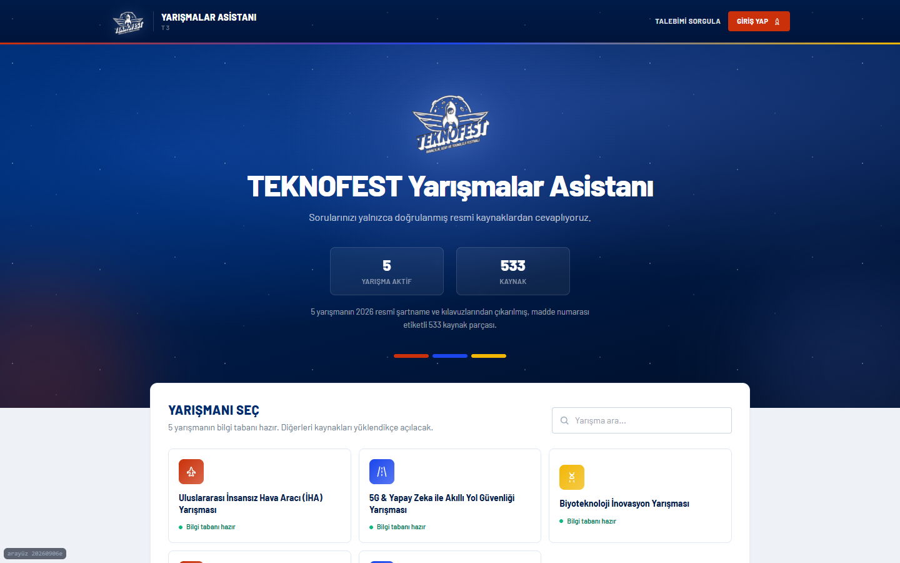
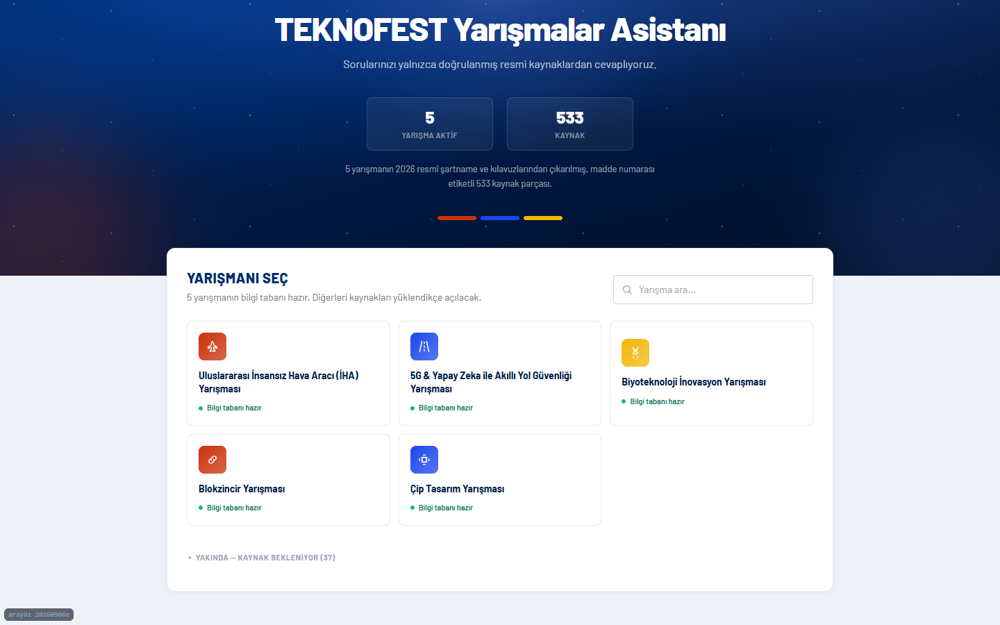
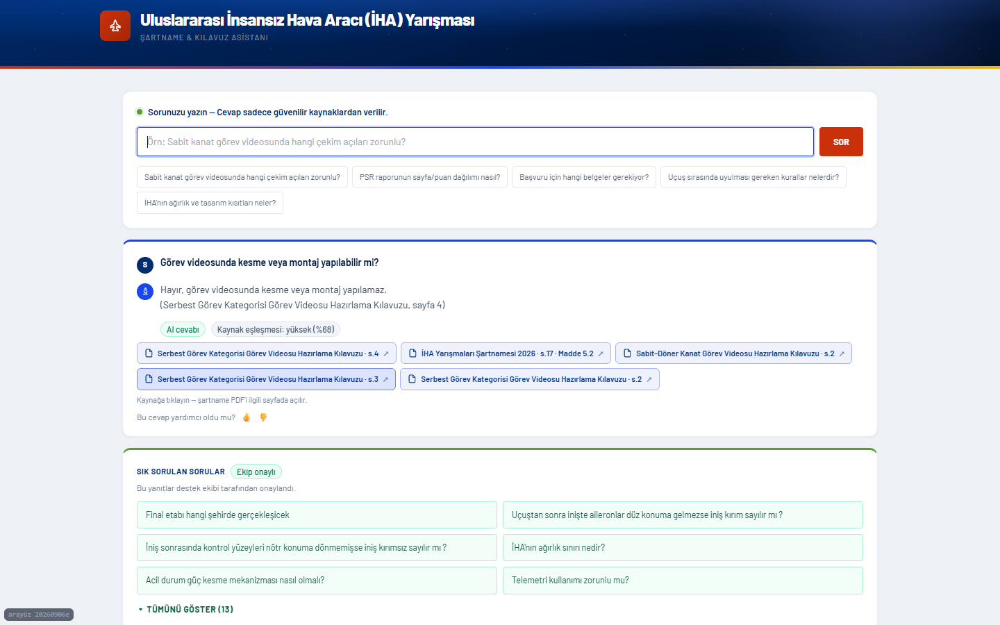
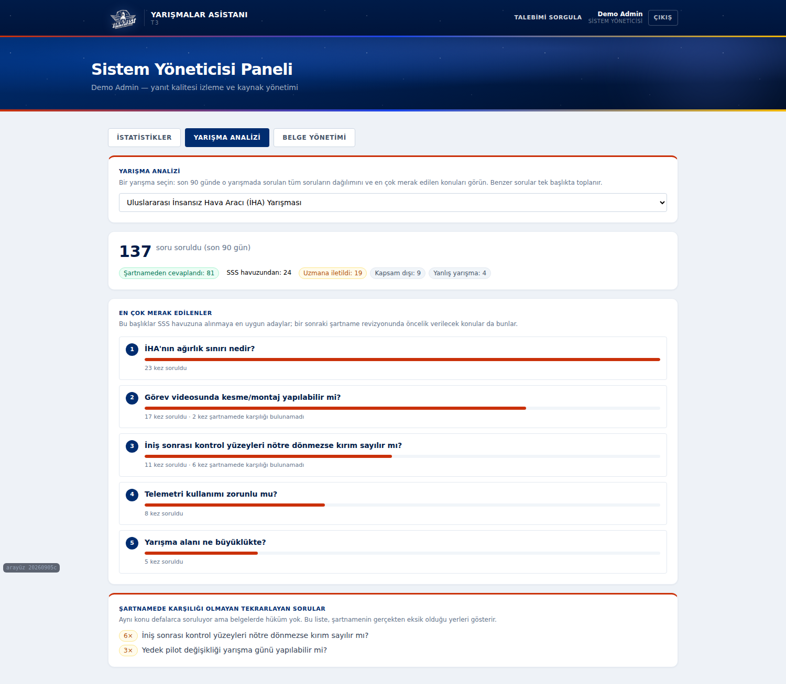
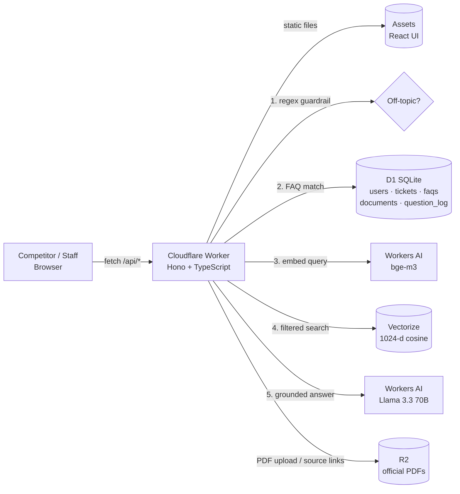

<div align="center">

# 🛰️ TEKNOFEST Competition Assistant

**A source-grounded RAG assistant that answers competitors' questions using only the official competition specifications, and hands the question to a human expert when it is not confident.**

[](https://yarismalar-asistani.farukakpinar301.workers.dev)


*Built for the **T3 Foundation AI Creathon 2026**, Problem 5: "TEKNOFEST / UAV FAQ & Chatbot Assistant".*
*Team **Gazi Uzay***

[**▶ Try the live demo**](https://yarismalar-asistani.farukakpinar301.workers.dev) · [Architecture](docs/ARCHITECTURE.md) · [Development Journey](docs/DEVELOPMENT_JOURNEY.md) · [Pitch Deck (TR)](docs/pitch/pitch-deck-tr.pdf)



</div>

---

## 📌 The Problem

Every year thousands of students compete in TEKNOFEST, Türkiye's largest aerospace and technology festival. Each competition has its own specification and guideline documents, often 60+ pages long, and the organizing committee gets the same questions again and again: *"Can we cut the mission video?"*, *"What is the weight limit?"*, *"Is telemetry mandatory?"*

**We experienced this ourselves.** Our team competes in TEKNOFEST UAV competitions. This year we were eliminated from the Fixed-Wing category, and one of the reasons was a criterion that the guideline never defined. We asked about it, but the answer did not arrive before the video submission deadline. Instead of arguing about the decision, we decided to build a tool so this would not happen to other teams.

The rules themselves are hard to search. For example, the video evaluation requires a *"landing without damage"* (Clause 5.2), but what counts as damage is defined 13 pages later in Clause 8.3.7, which never uses the same word, so a Ctrl+F search cannot find it.

General-purpose chatbots are risky here. They answer from their training data, cannot cite the clause they relied on, and do not stay silent when they don't know. A wrong answer about a rule can get a team disqualified.

## 💡 The Solution

A Retrieval-Augmented Generation (RAG) assistant that:

- **Answers only from verified official documents.** The LLM sees only the retrieved specification chunks and cites the page and clause number of every claim.
- **Refuses to guess.** If retrieval confidence is below a threshold, the LLM is never called. The question becomes a support ticket for a human reviewer.
- **Learns from humans.** Reviewers answer escalated questions and can promote good answers into a curated FAQ pool. Repeated questions are then answered instantly, with no LLM call.
- **Lets non-developers manage the knowledge base.** A content manager uploads a new specification PDF from the browser. It is chunked, embedded and indexed automatically, and the outdated version can be deactivated with one click.

## ✨ Features

| | Requirement (from the challenge brief) | How it is implemented |
|---|---|---|
| 1 | **Verified source pool** | PDFs uploaded via the Content Manager panel → stored in R2 → parsed with `unpdf` → clause-aware chunking → embedded. Each document has a version and an `active / passive` status. |
| 2 | **Natural-language Q&A (RAG)** | `bge-m3` multilingual embeddings → semantic search in Cloudflare Vectorize (top-k = 5) → `Llama 3.3 70B` generates an answer from the retrieved chunks only. |
| 3 | **Source citation** | Every answer shows clickable badges (*document · page · clause*) that open the official PDF on the cited page. |
| 4 | **Confidence level** | Below `CONFIDENCE_THRESHOLD = 0.45` no answer is generated and the user is offered a support ticket. Below `SCOPE_THRESHOLD = 0.28` the question is rejected as out of scope. |
| 5 | **Competition context isolation** | The user picks a competition first, and Vectorize queries are filtered by `competition_id`, so a UAV question can never be answered from the Blockchain specification. |
| 6 | **Human hand-off + growing FAQ** | Low-confidence questions open a ticket → reviewer answers → *"Add to FAQ pool"* turns it into a permanent, source-linked FAQ. |

**Extra engineering work**

- 🛡️ **Two-stage guardrail:** a Unicode-aware regex pre-filter catches off-topic requests (poems, code, translation, prompt injection such as *"forget the previous instructions"*) **before** any model call. It handles Turkish morphology, where JavaScript's `\b` silently fails on characters like `ş`, `ç` and `ö`.
- 🔁 **Follow-up question handling:** short follow-ups like *"what about rotary-wing?"* are merged with the previous question before retrieval.
- ⚡ **FAQ-first answering:** questions similar to a curated FAQ are answered from the database without calling the LLM, so cost per question goes down as the system is used.
- 📊 **Analytics dashboard:** every question is logged with its outcome (answered from spec / from FAQ / escalated / out of scope / wrong competition), so admins can see which topics are asked most and which rules are missing from the specification.
- 👥 **Five roles with token-based auth:** Competitor, Reviewer, Coordinator, Content Manager, System Admin. HMAC-signed tokens, salted SHA-256 password hashes, and reviewers can be scoped to specific competitions.

## 🖼️ Screenshots

| Competition selection | Source-cited answer |
|---|---|
|  |  |

| Admin analytics: most-asked topics and gaps in the specification |
|---|
|  |

> The user interface is in Turkish because the target users are TEKNOFEST competitors in Türkiye. The code and documentation are in English and Turkish.

## 🏗️ Architecture



Everything runs on Cloudflare's serverless edge: there is no server to maintain and no cost when the system is idle. See **[docs/ARCHITECTURE.md](docs/ARCHITECTURE.md)** for the full request flow, data model and API reference.

### Tech stack

| Layer | Technology |
|---|---|
| Backend | Cloudflare Workers, [Hono](https://hono.dev), TypeScript |
| AI | Workers AI: `@cf/baai/bge-m3` (embeddings), `@cf/meta/llama-3.3-70b-instruct-fp8-fast` (generation) |
| Vector DB | Cloudflare Vectorize (1024-dim, cosine, `competition_id` metadata index) |
| Database | Cloudflare D1 (SQLite) |
| Object storage | Cloudflare R2 |
| Frontend | React 18 (no build step, `createElement`) + Tailwind CSS |
| PDF processing | `unpdf` (in-Worker), `pdfplumber` (offline batch script) |

## 📂 Repository Structure

```
├── src/worker/
│   ├── index.ts        # Hono API: chat, tickets, FAQ, auth, content management, analytics
│   ├── rag.ts          # Retrieval pipeline, confidence thresholds, guardrails, prompt
│   ├── chunker.ts      # Clause-aware PDF chunking (detects "2.3. Title" headings)
│   ├── auth.ts         # HMAC tokens, salted password hashing, role middleware
│   └── types.ts
├── public/
│   ├── index.html
│   ├── app.js          # Single-page React app (all 5 role screens)
│   └── kaynak/         # Official PDFs served for source links (not committed)
├── scripts/
│   ├── chunk_new.py    # Offline batch chunking of specification PDFs
│   ├── ingest.mjs      # Embeds chunks via the Workers AI REST API → NDJSON for Vectorize
│   └── migrations/     # schema.sql + migration_v2 … v13 (the schema's full history)
├── docs/
│   ├── ARCHITECTURE.md
│   ├── DEVELOPMENT_JOURNEY.md
│   ├── pitch/          # Pitch deck + business model canvas (Turkish)
│   └── screenshots/
└── wrangler.toml
```

## 🚀 Getting Started

**Prerequisites:** a Cloudflare account (the free tier is enough) and Node.js 18+.

```bash
git clone https://github.com/F-AKPINAR/teknofest-competition-assistant.git
cd teknofest-competition-assistant
npm install
npx wrangler login
```

**1. Create the Cloudflare resources**

```bash
npx wrangler d1 create iha-sss-db          # paste the returned database_id into wrangler.toml
npm run vectorize:create
npm run vectorize:create-metadata-index
npm run r2:create
```

**2. Create the database schema**

```bash
npm run db:schema:remote
# then apply scripts/migrations/migration_v2 … v13 in order, e.g.
npm run db:migrate-v2:remote
```

**3. Set the secrets**

```bash
npx wrangler secret put AUTH_SECRET     # any long random string
npx wrangler secret put SETUP_KEY       # protects the one-time /api/setup endpoint
npx wrangler secret put DEMO_PASSWORD   # password for the seeded demo staff accounts
```

**4. Build the knowledge base**

Download the official specification PDFs from [teknofest.org](https://www.teknofest.org), then:

```bash
pip install pdfplumber
python scripts/chunk_new.py ./source-docs            # -> knowledge/chunks_new.json
CF_ACCOUNT_ID=... CF_API_TOKEN=... npm run ingest:new # -> knowledge/vectors_new.ndjson
npm run vectorize:insert-new
```

Alternatively, deploy first and upload PDFs from the **Content Manager** panel in the browser. They are chunked and indexed automatically.

**5. Deploy**

```bash
npm run deploy
# open https://<your-worker>.workers.dev/api/setup?key=<SETUP_KEY> once
# then check https://<your-worker>.workers.dev/api/health
```

For local development, create a `.dev.vars` file containing `AUTH_SECRET`, `SETUP_KEY` and `DEMO_PASSWORD`, then run `npm run dev`.

## 🧭 Development Journey

The project went from idea to a deployed product in **about 10 days**: a working prototype in the first weekend, then 13 schema migrations, a full UI redesign and five competitions loaded before the submission deadline. The whole story, including the bugs we hit and the design decisions we made, is in **[docs/DEVELOPMENT_JOURNEY.md](docs/DEVELOPMENT_JOURNEY.md)**.

## 🗺️ Known Limitations & Roadmap

Being honest about what the system does not do yet:

- **Source precedence:** document validity is binary (active/passive). Automatic precedence, where a later addendum overrides a specific clause, is not implemented yet.
- **Threshold calibration:** `0.45` is an engineering starting value, not a calibrated one. The plan is to tune it from the hand-off rate measured in the admin dashboard.
- **Identity:** Team ID / Application ID are entered manually. A pilot would use SSO with the organizer's management system.
- **Evaluation:** there is no automated retrieval/answer-quality benchmark yet. A labelled question set is the next step.

## 👥 Team Gazi Uzay

*Gaziantep University, Gazi Uzay & Technology Club*

| Member | Role |
|---|---|
| **Ömer Faruk Akpınar** | Team captain: problem analysis, product design, system development (full stack, RAG pipeline, deployment) |
| **Semihcan Işık** | Testing, content and demo video production |
| **Ahmet Kadim Koç** | Validation, source management, user testing |

AI pair-programming tools (Claude) were used during development and for preparing the pitch materials.

## 🙏 Acknowledgements

- **T3 Foundation** for organizing the AI Creathon and providing the problem brief.
- Abdullah Çiçekli's *"From Idea to Live Product"* Cloudflare workshop, which provided the initial Workers + D1 + Vectorize scaffold.

## ⚖️ License & Disclaimer

The source code is released under the [MIT License](LICENSE).

This is an independent competition prototype. It is **not affiliated with or endorsed by TEKNOFEST, T3 Foundation or TÜBİTAK**. The TEKNOFEST name and logo belong to their respective owners. Official specification documents are not redistributed in this repository. Always check answers against the official documents at [teknofest.org](https://www.teknofest.org).
