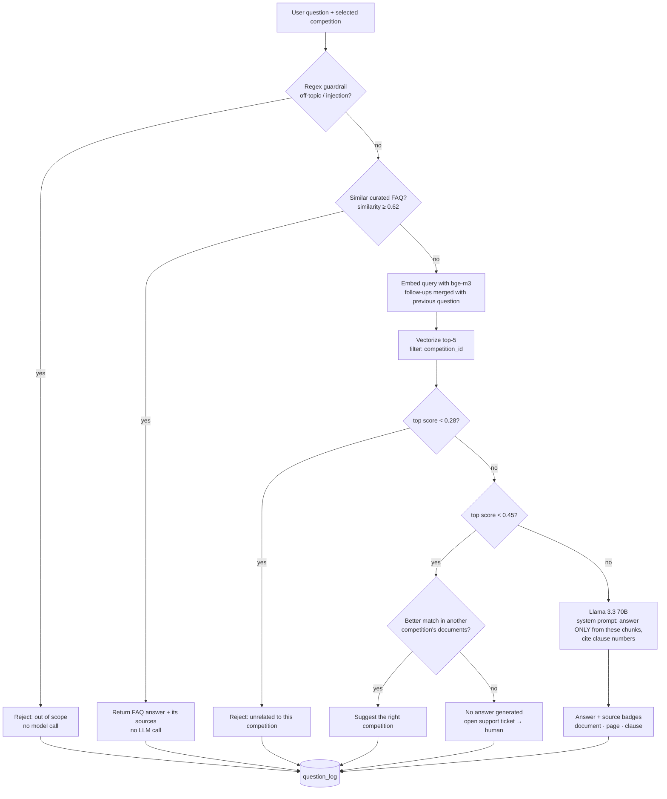
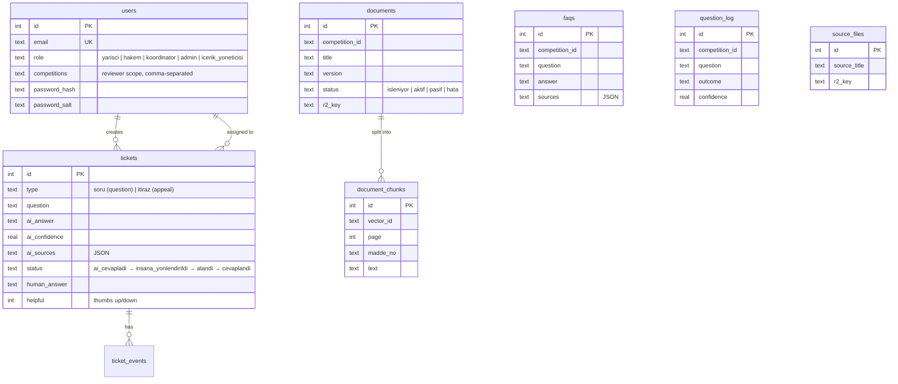

# Architecture

← Back to [README](../README.md)

## 1. Overview

The application is a single Cloudflare Worker. It serves the static React frontend and a JSON API, and it uses four Cloudflare services through bindings:

| Binding | Service | Purpose |
|---|---|---|
| `AI` | Workers AI | Query/document embeddings (`bge-m3`) and answer generation (`Llama 3.3 70B`) |
| `VECTORIZE_INDEX` | Vectorize | Semantic search over specification chunks (1024-dim, cosine) |
| `DB` | D1 (SQLite) | Users, tickets, FAQs, documents, question log |
| `DOCS_BUCKET` | R2 | Raw PDFs uploaded by the Content Manager |
| `ASSETS` | Static assets | `public/` (React SPA, logo, source PDFs) |

## 2. Question-answering pipeline

### Key design decisions

- **Gate the LLM, don't just instruct it.** Prompt instructions like "don't make things up" can be bypassed. A similarity threshold that decides whether the model is called at all cannot. When evidence is weak, no text is generated.
- **Clause-aware chunking.** `chunker.ts` detects numbered headings such as `5.2. Görev Videosu` and attaches `madde_no` / `madde_title` metadata to each chunk (40–1800 characters), so citations point to a specific clause rather than just a page.
- **Metadata-filtered retrieval.** Every vector carries `competition_id`, and queries are filtered on it, which isolates contexts between competitions.
- **FAQ-first.** Human-approved answers are checked before RAG. This is faster and cheaper, and the answers are guaranteed correct.
- **Turkish-aware guardrails.** JavaScript's `\b` only works on `[A-Za-z0-9_]`, so a pattern like `/\bşiir\b/` never matches. `rag.ts` builds its own Unicode boundaries (`(?<![\p{L}\p{N}])`) and root-plus-suffix patterns to cover Turkish inflection.

## 3. Data model (D1)

The schema evolved through 13 migrations (`scripts/migrations/`) applied to the live database without losing data. Because running migrations by hand turned out to be fragile, the `/api/setup` endpoint can also bring an older database up to the current schema idempotently.

## 4. Roles

| Role | Screen | Capabilities |
|---|---|---|
| Competitor (`yarisci`) | Home + chat | Choose a competition, ask questions, rate answers, open a ticket or appeal, track ticket status |
| Reviewer (`hakem`) | Staff panel | See escalated tickets **for assigned competitions only**, answer, promote to FAQ |
| Coordinator (`koordinator`) | Staff panel | Same as reviewer, across all competitions |
| Content Manager (`icerik_yoneticisi`) | Content panel | Upload specification PDFs, track processing, activate/deactivate sources |
| System Admin (`admin`) | Admin dashboard | Answer-quality stats, hand-off rate, most-asked topics, specification gaps |

## 5. API reference (main endpoints)

| Method | Path | Auth | Description |
|---|---|---|---|
| `POST` | `/api/chat` | – | Ask a question (`question`, `competition`, optional history) |
| `POST` | `/api/itiraz` | – | Submit an appeal / feedback ticket |
| `GET` | `/api/my-tickets` | – | Track a ticket by number |
| `POST` | `/api/tickets/:id/feedback` | – | 👍 / 👎 on an AI answer |
| `GET` | `/api/faqs` | – | FAQ pool for a competition |
| `GET` | `/api/ready-competitions` | – | Competitions with an indexed knowledge base |
| `POST` | `/api/auth/login` | – | Staff login → signed token (24 h) |
| `GET` | `/api/tickets` | staff | Ticket queue (scoped by reviewer competitions) |
| `POST` | `/api/tickets/:id/assign` · `/answer` | reviewer+ | Assign / answer a ticket |
| `POST` | `/api/tickets/:id/promote-to-faq` | staff | Turn an answered ticket into an FAQ |
| `POST` | `/api/admin/documents` | content mgr / admin | Upload a PDF (stored in R2) |
| `POST` | `/api/admin/documents/:id/process-batch` | content mgr / admin | Chunk + embed + index in batches (stays within the Worker CPU limit) |
| `POST` | `/api/admin/documents/:id/toggle-status` | content mgr / admin | Activate / deactivate a source |
| `GET` | `/api/admin/stats` · `/api/admin/analiz` | admin / staff | Dashboard metrics and per-competition analysis |
| `GET` | `/api/health` | – | Deployment diagnostics (missing tables / secrets) |
| `GET` | `/api/setup?key=` | `SETUP_KEY` | Idempotent one-time schema completion + demo account seeding |

## 6. Security notes

- Passwords: salted SHA-256 (Web Crypto). Tokens: HMAC-SHA256 signed with the `AUTH_SECRET` secret.
- No secrets are committed. `AUTH_SECRET`, `SETUP_KEY` and `DEMO_PASSWORD` are Worker secrets, and the demo account hashes were removed from the public migrations.
- Role checks are enforced server-side by the `requireAuth([...roles])` middleware, not only in the UI.
- Known prototype simplification: Team ID / Application ID on tickets are not verified against an identity provider.
